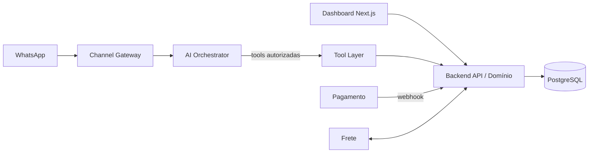

# ARCHITECTURE (v0.1)

Decisão base: **ADR-0001 — monólito modular**.

## Camadas
- **Canais:** recebem/enviam mensagens; normalizam eventos.
- **AI Orchestrator:** prompts, memória de conversa por tenant/cliente, chamadas de tools. Sem acesso a banco.
- **Tool Layer:** única interface da IA com o sistema; allowlist, schema validado, permissões por tenant, auditoria.
- **Domínio/API:** módulos `tenants, auth, catalog, inventory, orders, payments, shipping, conversations, analytics`. Regras de negócio e validação final.
- **Dados:** PostgreSQL, `tenant_id` em todas as tabelas, row-level isolation.

## Princípios
Backend = fonte da verdade · idempotência · eventos auditáveis · módulos com fronteiras claras · contratos versionados em `CONTEXT/contracts/`.

## Fluxo de venda
Mensagem → Orchestrator → tool `search_products` → `check_stock` → `create_order` → `create_payment_link` → webhook confirma pagamento (backend) → reserva/baixa estoque → notificação.

Detalhes por área em `CONTEXT/architecture/`.
